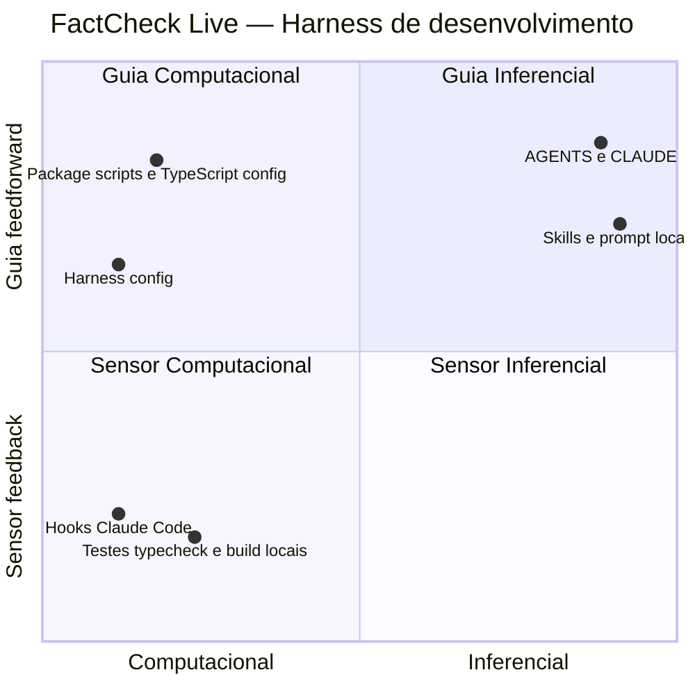

# FactCheck Live — Análise de Harness por Quadrante Guias × Sensores

## Metodologia

Harness de desenvolvimento é a combinação de guias e sensores que governa como
o agente de codificação atua.

Este documento usa o quadrante guias×sensores:
- X: Computacional --> Inferencial
- Y: Sensor feedback --> Guia feedforward

As coordenadas são qualitativas (priorização visual), não métricas exatas.
Computacional indica aplicação ou verificação automática; inferencial depende
da leitura e interpretação por agente ou pessoa. Guia orienta antes ou durante
a ação; sensor verifica ou bloqueia uma ação.

A inspeção foi estática e orientada aos artefatos de harness, manifest/configs,
testes, prompts e skills. Não foram executados os gates do projeto nem
verificados runs de CI, práticas de revisão de PR ou adoção real. Ausências
foram conferidas na estrutura do repositório e no `package.json`.

## Notas do Harness

- **Data da avaliação**: 2026-10-12
- **Escopo**: repositório `emilianoeloi/elections-fact-check`, guias, configurações, sensores locais e guardrails de agente.
- **Confiança**: média — boa evidência dos arquivos presentes; não foram avaliados uso real, PRs, execução de CI ou práticas fora do repositório.

### Nota de eficácia: 5.8/10 (média das dimensões conhecidas x 2)

| Dimensão | Pontuação (0–5) | Evidência (arquivo-fonte) | Justificativa |
|---|---:|---|---|
| Clareza das guias | 4 | [AGENTS.md](../AGENTS.md), [CLAUDE.md](../CLAUDE.md) | Há fonte única, regras operacionais e quality gates; o guia ainda não especifica exemplos para todas as regras arquiteturais. |
| Automação | 2.5 | [package.json](../package.json), [settings.json](../.claude/settings.json), [harness.config.json](../harness.config.json) | Existem scripts de teste/tipos/build e guardrails Claude; não há CI, lint, pre-commit ou scanner automatizado identificado. |
| Cobertura de feedback | 2.5 | [package.json](../package.json), [tests/](../tests), [scripts/hooks/](../scripts/hooks) | Há testes e typecheck, além de bloqueios de segurança no uso do Claude Code; faltam feedback automático em CI, fitness functions e scans de segurança. |
| Rastreabilidade/evolução | 2.5 | [AGENTS.md](../AGENTS.md), [dev-harness-architect/SKILL.md](../.github/skills/dev-harness-architect/SKILL.md), [architecture-fitness-functions/SKILL.md](../.github/skills/architecture-fitness-functions/SKILL.md) | Regras e processo para evoluir o harness estão documentados; ainda não há sensor estrutural para garantir regras documentadas nem pipeline que aplique os gates. |
| Adoção/baixo atrito | Desconhecida | — | Os comandos e hooks sugerem baixo atrito de configuração, mas os arquivos não demonstram se os checks são executados ou adotados na prática. Excluída do cálculo. |

Cálculo: `(4 + 2.5 + 2.5 + 2.5) / 4 × 2 = 5.75`, arredondado para **5.8**.

### Nota de complexidade/tamanho: 4/10 (leve)

- **Evidência**: fonte de regras única, guia fino do Claude Code, configuração
  de hooks, três scripts de hook e um CLI auxiliar em
  [scripts/](../scripts). Não há tiers de CI, gate de fase ou conjunto extenso
  de verificações locais que aumente o custo operacional.

### Limitações e próximos passos

- **Limitações**: avaliação estática; execução dos testes/build/typecheck,
  proteção dos hooks contra todos os vetores possíveis, configuração de branch
  protection, histórico de PRs e adoção pelos colaboradores não foram
  verificados. Não se encontrou configuração de CI, pre-commit, linter,
  formatter, scanner de segurança ou fitness function no escopo inspecionado.
- **Próximos passos**: adicionar workflow de CI para os comandos já definidos;
  criar fitness function para a fronteira extensão/backend; adicionar
  verificação automatizada de dependências e secrets.

## Contexto de Mercado

Contexto de mercado não verificado nesta avaliação — nenhuma fonte externa
verificável foi fornecida ou identificada no repositório. A nota interna de
eficácia/complexidade não equivale a uma média estatística do mercado.

## Diagrama

## Rastreabilidade

| Ponto | Arquivo-fonte | Quadrante | Justificativa |
|---|---|---|---|
| Regras principais e guia de Claude | [AGENTS.md](../AGENTS.md), [CLAUDE.md](../CLAUDE.md) | Guia Inferencial | Um documento contém as regras; o outro encaminha para a fonte única, exigindo interpretação pelo agente. |
| Skills e prompt do repositório | [`.github/skills/`](../.github/skills), [explorar.prompt.md](../.github/prompts/explorar.prompt.md) | Guia Inferencial | Conteúdo especializado orienta o agente antes de tarefas de harness e exploração. |
| Scripts npm e opções TypeScript | [package.json](../package.json), [tsconfig.json](../tsconfig.json) | Guia Computacional | Manifest e opções de compilador definem comandos e restrições mecânicas do projeto. |
| Política dos hooks | [harness.config.json](../harness.config.json) | Guia Computacional | Configura nomes/extensões bloqueados e padrões de comandos bloqueados. Não configura gate por fase. |
| Hooks de escrita, Bash e sessão | [settings.json](../.claude/settings.json), [scripts/hooks/](../scripts/hooks) | Sensor Computacional | Claude Code executa verificações automáticas durante as chamadas de ferramenta. |
| Testes, verificação de tipos e build | [package.json](../package.json), [tests/](../tests) | Sensor Computacional | Existem comandos automáticos executáveis localmente; não há evidência de execução obrigatória em CI. |

Não foi identificado sensor inferencial configurado no repositório (por exemplo,
um processo de revisão de PR documentado). Revisão humana pode ocorrer fora do
escopo dos arquivos inspecionados, mas não foi contada como ponto do quadrante.

## Lacunas priorizadas

| # | Lacuna | Risco | Próximo passo |
|---|---|---|---|
| 1 | Sem CI identificado para executar os quality gates | Alto | Criar `.github/workflows/ci.yml` com `npm run typecheck`, `npm test` e `npm run build`, acionados em PR e push. |
| 2 | Regras arquiteturais não têm fitness function | Alto | Adicionar teste estrutural em `tests/` que valide a separação entre extensão e backend e rode com `npm test`; usar a skill `architecture-fitness-functions`. |
| 3 | Sem scanner automatizado de dependências/secrets identificado | Médio | Adicionar auditoria de dependências e secret scanning em CI, com configuração e critérios de falha explícitos. |
| 4 | Sem lint/format identificados | Baixo | Decidir se vale padronizar lint e formatação; se sim, adicionar ferramentas e scripts ao `package.json` e executá-los em CI. |

## Próximas ações recomendadas

1. Colocar typecheck, testes e build sob CI obrigatório para PRs.
2. Criar uma fitness function para a fronteira de dependência entre extensão e backend.
3. Adicionar scans de dependências e secrets e só então decidir se lint/format trazem valor suficiente.
