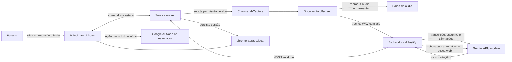
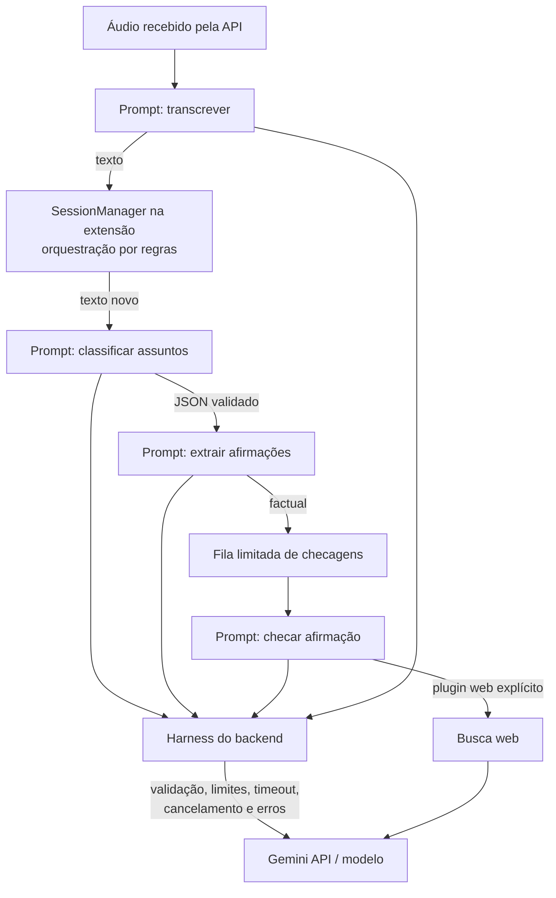
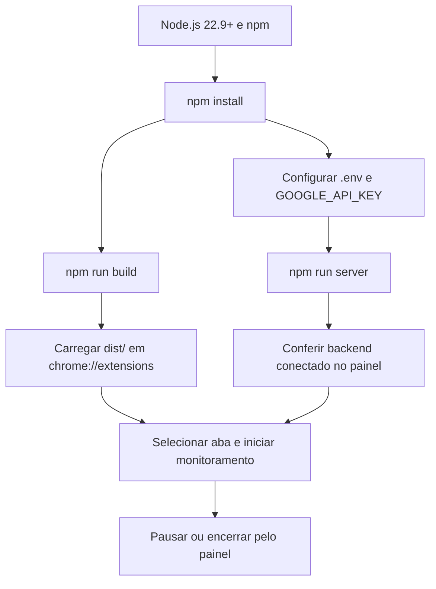
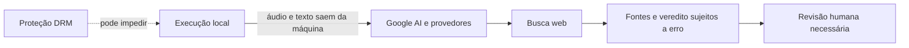

# FactCheck Live — visão visual

## Componentes e fluxo

## Harness e chamadas ao modelo

**Leitura do diagrama:** os prompts definem tarefas individuais. A sequência é definida pelo código da extensão e do backend, não planejada autonomamente pelo modelo. O harness é a camada de código que prepara, limita, valida e integra as chamadas. A busca web só é solicitada na checagem factual.

## Ciclo de execução local

## Confiança e limites

**Resumo:** fácil de experimentar para quem conhece npm e extensões unpacked; não é inteiramente local. Requer chave e pode gerar custos. Use apenas com conteúdo que possa ser enviado aos provedores externos, limite gastos e confira as fontes. O modo automático não é o Google AI Mode.
