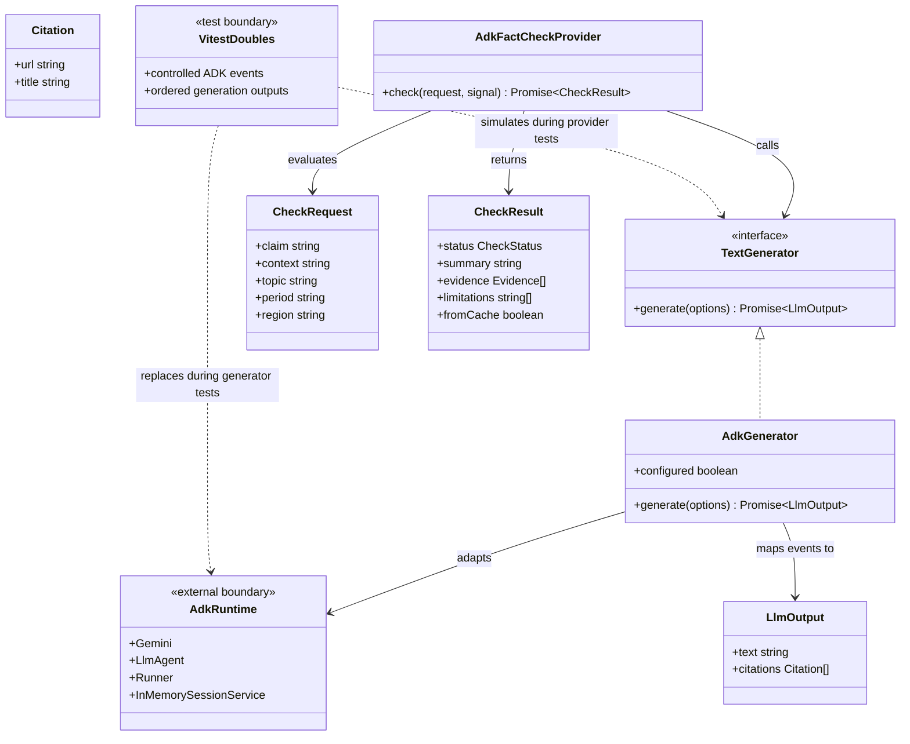

# Automated Tests for ADK Runtime Coverage

## Requirements

- Add deterministic automated coverage for the backend's Google ADK generator and grounded fact-check provider.
- Verify the existing runtime contracts without changing production behavior, prompts, HTTP APIs, dependencies, or provider policy.
- Ensure the regular test suite requires neither Google credentials nor network access.
- Keep live Gemini and Google Search smoke testing separate from the unit-test suite.

## Entities

The existing generator adapter owns the temporary ADK session lifecycle. The fact-check provider owns the research-to-verdict workflow, cache, and reconciliation against citations returned by grounded research. Test doubles control the external boundary; they do not represent or reproduce the remote service itself.

## Approach

1. **Generator adapter coverage**
   - Use Vitest module mocks for `@google/adk` in a dedicated generator test file.
   - Verify model and generation configuration, optional Google Search tool selection, text/audio input mapping, final-response handling, and grounding citation conversion.
   - Cover ADK error events, empty responses, configured timeout, caller abort, and session cleanup on successful and failing runs.
   - Keep assertions tied to the public `TextGenerator` contract and the installed ADK package's event types.

2. **Fact-check orchestration coverage**
   - Use an `AdkGenerator` instance with a stubbed `generate` method in a separate provider test file.
   - Verify grounded research happens before verdict formatting, the verdict call receives research and grounded source URLs, and final evidence is reconciled against research citations.
   - Verify a research response without citations returns `insufficient` without a second generation call.
   - Verify cache hits, invalid verdict parsing, provider failures, and signal forwarding.

3. **Error and cache semantics**
   - Preserve existing runtime behavior rather than changing policy to satisfy a test.
   - A completed no-citation result is a valid `insufficient` result and is cached by the current provider.
   - A rejected generation/parsing operation is a failure and must not cache a success-shaped result.
   - For caller cancellation, assert the existing observable rejection and signal propagation; do not require a new error type or status mapping.

4. **Verification**
   - Run the focused test files while developing.
   - Finish with `npm test`, `npm run typecheck`, and `npm run build`.
   - Confirm the new tests work without `GOOGLE_API_KEY` and do not make external requests.
   - Keep any live-service smoke test opt-in and outside the default test command.

## Structure

### Inheritance Relationships

1. `AdkGenerator` implements the existing `TextGenerator` contract.
2. `AdkFactCheckProvider` implements the existing `FactCheckProvider` contract.
3. Test doubles replace ADK classes/functions only in generator tests; a stubbed generator replaces the remote runtime boundary in provider tests.

### Dependencies

1. `AdkGenerator` creates ADK model, agent, runner, and in-memory session service objects and maps runner events to `LlmOutput`.
2. `AdkFactCheckProvider` calls the generator for grounded research and, when citations exist, for verdict formatting.
3. `reconcileVerdict` constrains check-result evidence to the grounded citations.
4. Dedicated Vitest files exercise those boundaries; existing `provider.test.ts` remains in place for shared reconciliation and legacy-provider behavior.

### Layered Architecture

1. **Application/domain layer**: defines generation, fact-checking, evidence, and error contracts.
2. **Runtime adapter layer**: implements `TextGenerator` over Google ADK.
3. **Fact-check provider layer**: orchestrates research and verdict formatting and applies cache/evidence policy.
4. **Test layer**: substitutes the remote ADK boundary and verifies adapter/provider contracts without modifying runtime source.

## Operations

### Create generator adapter tests - `tests/adk-generator.test.ts`

1. **Responsibility**: Verify `AdkGenerator` translates application inputs and options into ADK execution and translates ADK events back into the existing generation result.
2. **Test setup**:
   - Scope Vitest module mocks to this test file.
   - Provide controlled doubles for the model, agent, runner, session service, final-response predicate, and content stringifier.
   - Reset mock state between cases; never initialize a real client or read credential values.
3. **Cases and verification**:
   - Verify model name, API key presence handling, temperature/token settings, and Google Search tool inclusion only when requested.
   - Verify string input and text/audio multipart input, including MIME mapping, reach the runner in the expected ADK content structure.
   - Verify only final response content populates result text and web grounding chunks with usable URLs map to citations.
   - Verify ADK error events become observable `LlmError` instances without exposing the configured secret.
   - Verify empty final output is a parse failure.
   - Verify configured timeout and caller abort produce the existing observable failure behavior.
   - Verify the temporary session is deleted after a successful run and after runner/event failure.
4. **Completion criteria**: `npm test -- tests/adk-generator.test.ts` passes without network access or a configured Google API key.

### Create grounded provider tests - `tests/adk-fact-check-provider.test.ts`

1. **Responsibility**: Verify `AdkFactCheckProvider` orchestration and result policy using deterministic generator outputs.
2. **Test setup**:
   - Construct the real provider and an `AdkGenerator` instance.
   - Stub `generate` to return ordered research/verdict fixtures or reject.
   - Use fixed time and distinct claims where cache isolation is needed.
3. **Cases and verification**:
   - Verify the first call enables web search and the second call does not, and that the second input includes the research summary and grounded citation URLs.
   - Verify evidence in the final result is reconciled only against citations from the research response.
   - Verify zero research citations returns `insufficient`, caches the completed result according to existing behavior, and makes no verdict-formatting call.
   - Verify a repeated equivalent claim returns a cache hit without more generation calls.
   - Verify malformed verdict output and generator rejection propagate as provider errors and do not cache a success-shaped result.
   - Verify the caller's abort signal is forwarded through each applicable generation call and cancellation remains observable as rejection.
4. **Completion criteria**: `npm test -- tests/adk-fact-check-provider.test.ts` passes without network access or a configured Google API key.

### Verify suite integration

1. Run `npm test`.
2. Run `npm run typecheck`.
3. Run `npm run build`.
4. Confirm the full suite passes with no Google credentials and no external Gemini/Search request.
5. Confirm production source and public HTTP contracts are unchanged by this test-only work.

## Norms

1. Follow existing Vitest and TypeScript conventions in `tests/`; use typed fixtures and avoid unsafe casts.
2. Keep generator adapter tests separate from provider orchestration tests.
3. Use controlled fakes for external systems; no credentials, `.env` reads, or network calls in default tests.
4. Clear/reset mocks and timers between test cases so failures do not depend on execution order.
5. Preserve existing `LlmError`, `ProviderError`, cache, citation, and cancellation semantics; change runtime code only if the user separately authorizes a scope expansion after a concrete testability blocker is demonstrated.
6. Keep `tests/provider.test.ts` and its legacy provider/reconciliation coverage intact.

## Safeguards

1. **Functional constraints**: Tests must cover the adapter mapping, grounded fact-check sequence, no-citation behavior, evidence reconciliation, cache hits, failure propagation, cancellation signal forwarding, and session cleanup.
2. **Performance constraints**: No timing-sensitive waits or live service calls in the unit suite; control timeout behavior with deterministic test mechanisms.
3. **Security constraints**: Never hardcode or log credentials; tests must not inspect or mutate `.env`; ensure error assertions do not expose API key values.
4. **Integration constraints**: Use the installed ADK package types and event shape; do not assert undocumented remote Gemini or Search behavior as guaranteed.
5. **Business-rule constraints**: A lack of citations remains `insufficient`, never `contradicted`; evidence remains restricted to grounded citations.
6. **Compatibility constraints**: Do not change extension/backend HTTP contracts, production prompts, provider identifiers, or runtime policy.
7. **Test boundary constraints**: Unit tests prove application-side mapping and orchestration, not remote service availability, search quality, or correctness of the model's judgment.
8. **Quality gates**: The focused tests, full `npm test`, `npm run typecheck`, and `npm run build` must pass before the implementation is considered complete.
